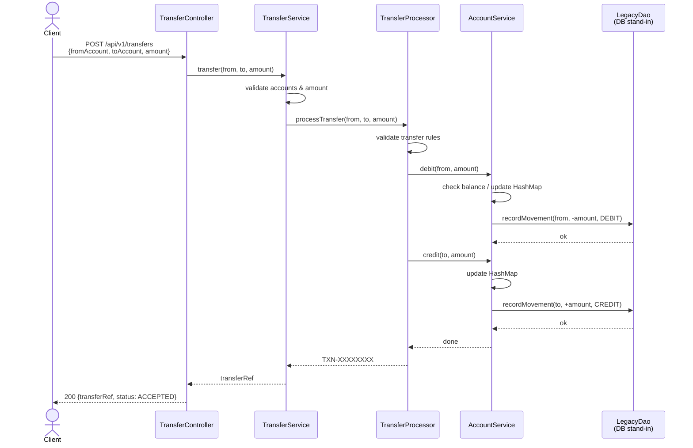

# Fund Transfer Architecture

ลำดับการโอนเงินเริ่มที่ `TransferController` ผ่าน `TransferService` เข้า `TransferProcessor` / `AccountService` แล้วบันทึก movement ที่ `LegacyDao` (stand-in ของ database แบบ in-memory สำหรับ demo — ปัจจุบัน `transfer-api` ยังเป็น stub ที่ยังไม่ได้เรียก `core-banking`)

